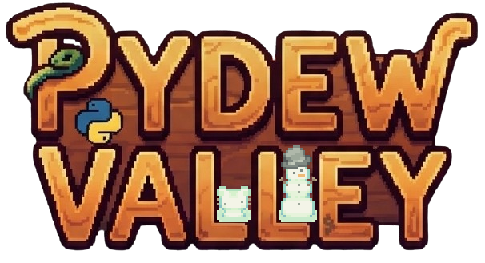

A 2D isometric farming, crafting, mining and exploration game built with Python and Pygame.

Version 3.0 - Windows, macOS and Linux

---

## Download and play

Download the ZIP for your operating system from the project's
[GitHub Releases](https://github.com/PURABZo2659C/PYDEW-VALLEY/releases)
page. Each release includes:

| ZIP file | Platform | How to start |
|---|---|---|
| `Pydew-Valley-v3.0-windows.zip` | 64-bit Windows | Extract the ZIP, open the `Pydew Valley` folder and run `PydewValley.exe`. |
| `Pydew-Valley-v3.0-macos-x86_64.zip` | macOS, Intel and Apple Silicon | Extract the ZIP, move `PydewValley.app` to a folder you can write to, then open it. See [macOS install](#macos-install-intel-and-apple-silicon). |
| `Pydew-Valley-v3.0-linux.zip` | 64-bit Linux | Extract the ZIP, then run `./PydewValley` from a terminal in the extracted folder. |

There is no installer. Extract the download to a folder you can write to.
On Linux, if the executable does not start because it is not marked
executable, run `chmod +x PydewValley` first. The Linux build targets
64-bit systems and needs a graphical desktop with SDL-compatible
libraries.

The game opens full screen and stretches to your display resolution. The
in-game help page is available from the **HELP** button on the title
screen.

### macOS install (Intel and Apple Silicon)

The macOS download is one **x86_64** app. It runs natively on Intel Macs
and through **Rosetta 2** on every Apple Silicon Mac (M1, M2, M3, M4 and
later). Rosetta is Apple's own translator and is installed once; after
that the game starts like any other app.

1. Download `Pydew-Valley-v3.0-macos-x86_64.zip` and double-click it.
   Finder unpacks `PydewValley.app`.
2. Move `PydewValley.app` to a folder your account owns, for example
   `~/Games/PydewValley/`. Do not play it from inside the ZIP, and do not
   leave it on a read-only disk image.
3. First launch: **double-click** `PydewValley.app`.
   - On Apple Silicon, macOS asks to install Rosetta. Click **Install**,
     enter your password and wait about a minute.
   - If that prompt never appears, open **Terminal** and run:
     `softwareupdate --install-rosetta --agree-to-license`
4. macOS then reports that the app is from an unidentified developer,
   because it is not notarized. Approve it once:
   - **Control-click** (or right-click) `PydewValley.app`, choose
     **Open**, then **Open** in the dialog.
   - Or open **System Settings -> Privacy & Security**, scroll to the
     security message, click **Open Anyway** and confirm.
5. The game opens full screen. Every later launch is a normal
   double-click.

If macOS says the app "is damaged and can't be opened", the download is
still quarantined. With the app already moved to its final folder, run:

```sh
xattr -dr com.apple.quarantine ~/Games/PydewValley/PydewValley.app
```

**Saves on macOS.** The game writes `save.json`, `keybindings.json` and
`volume.json` inside `PydewValley.app/Contents/MacOS/`, next to the game
binary, so the app must stay in a folder you can write to. Before
replacing the app with a newer version, copy those files out of
`Contents/MacOS/` and move them into the new app's `Contents/MacOS/`
folder. Keeping the old `.app` until the save has been checked is a cheap
backup.

### Saves and settings

The game stores `save.json`, `keybindings.json`, `volume.json`,
screenshots and (if needed) `game.log` next to the game executable.
Keep the extracted game in a folder where your account has write
permission. To back up progress, close the game and copy `save.json`;
to move your settings too, also copy `keybindings.json` and
`volume.json`. When updating, back up these files before replacing the
old game files. On macOS, "next to the executable" means inside
`PydewValley.app/Contents/MacOS/` - see
[macOS install](#macos-install-intel-and-apple-silicon).

The Windows ZIP contains just the executable and the HTML help page. The
macOS and Linux packages contain their respective PyInstaller
app/executable bundles.

### Platform notes

- **Windows:** Windows may show a security warning for an unsigned
  download. Only run software you trust.
- **macOS:** The build is x86_64 and not notarized, so macOS needs two
  approvals the first time: install Rosetta on Apple Silicon, then allow
  the app. Both are covered in
  [macOS install](#macos-install-intel-and-apple-silicon).
- **Linux:** Run the executable from its extracted folder so it can
  access its bundled files and write its save data.

### Controls

The controls are shown in the in-game help page and can be rebound from
the pause menu. The defaults are:

| Key | Action |
|---|---|
| `W` `A` `S` `D` | Move |
| `Enter` | Use the tool |
| `Right Shift` | Use / interact with the item in front of you |
| `E` | Inventory |
| `C` | Crafting |
| `Q` | Drop the held item |
| `1` - `9` | Pick a hotbar slot |
| `Esc` | Pause menu |

---

## Building it

The game source is at the top of this repository; the build tooling
lives in the `APP\` folder.

```
code\        the game
graphics\    art
audio\       music and sound
font\        fonts
data\        the starting map
APP\         build tooling - build.bat, the PyInstaller spec, scripts
```

Requirements for building: **Python 3.11+** with `pygame`, `numpy`,
`pytmx`, `opencv-python`, `PyInstaller` and `Pillow` installed. Build
each platform on that platform; PyInstaller does not cross-compile.

```
pip install pygame numpy pytmx opencv-python
pip install pyinstaller pillow
```

### Build Windows

Run these commands in **Command Prompt** from the repository root:

```
cd APP
build.bat              REM exe + Windows ZIP
build.bat exe          REM executable only
build.bat zip          REM Windows ZIP only
build.bat folder       REM folder build only
build.bat all          REM exe + Windows ZIP (used by CI)
```

The Windows package is written to
`APP\dist\Pydew Valley [v<version>] Windows.zip`. PyInstaller cannot
cross-compile, so the macOS and Linux packages are built by the release
workflow.

### Build macOS and Linux

On the target OS, install the build dependencies above, then run these
commands from the repository root.

```sh
cd APP
python build/make_version_info.py
python build/make_icon.py
python build/fix_line_endings.py
python -m PyInstaller --clean --noconfirm --workpath "${TMPDIR:-/tmp}/pydew-valley-pyinstaller" PydewValley.spec
```

On macOS this creates `APP\dist\PydewValley.app`; on Linux it creates
`APP\dist\PydewValley`. Create the macOS release ZIP with:

```sh
cd APP
VER=$(cat build/VERSION.txt)
cd dist
ditto -c -k --sequesterRsrc --keepParent "PydewValley.app" "Pydew-Valley-v${VER}-macos-x86_64.zip"
```

For Linux, use:

```sh
cd APP
VER=$(cat build/VERSION.txt)
cd dist
zip "Pydew-Valley-v${VER}-linux.zip" PydewValley
```

The PyInstaller work files, including its HTML cross-reference report,
are stored under the system temporary directory instead of
`APP\build\`.

The automated release workflow performs these steps and publishes the
Windows, macOS and Linux ZIPs together.
`build.bat` builds only the Windows outputs.

The version number comes from `APP\build\VERSION.txt`. That one file is
the single source of truth: the exe's file properties, the ZIP name and
the credits screen all read it. Bump it and rebuild to publish a new
version.

GitHub Actions builds the Windows, macOS and Linux ZIPs for each release. Push a `v*` tag or run **Build and Release** from
the Actions tab with a release tag matching `APP\build\VERSION.txt`.
Wait for the platform jobs to finish; the workflow then creates or
updates one GitHub Release with every ZIP attached. The version comes
from `APP\build\VERSION.txt`; use a corresponding tag when publishing a
release.

`APP\DISTRIBUTING.md` has additional Windows distribution notes,
including Smart App Control and code signing.

---

## Third-party assets

This game uses third-party art, fonts and music. The full list, with the
authors and their licence terms, is in
[`APP/THIRD_PARTY_NOTICES.txt`](APP/THIRD_PARTY_NOTICES.txt) and is
shipped with the game.

The short version:

* All art is **Sprout Lands** by Cup Nooble.
* The interface font is **Monocraft** by Idrees Inc (SIL OFL 1.1).
* The title screen music is **Yoiyami** (CC0); the in-game music is
  *"8bit attempt"* by Daniel Stephens.
* The project grew out of the **Clear Code** tutorial *"Creating a
  Stardew Valley-inspired game in Python and Pygame"*.

---

## Licence

The game code is MIT licensed - see [`LICENSE`](LICENSE).
